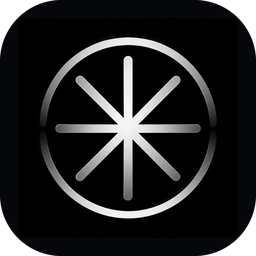

<div align="center">
  
  <h1>Oxygen</h1>
  <p><strong>Make Your Browser Yours.</strong> — a customization layer for <a href="https://github.com/imputnet/helium">Helium</a> (Alpha 0.2)</p>
</div>

Oxygen runs on stock Helium as a Manifest V3 extension plus a theme pack. No
Chromium build is needed. The earlier source fork (patches, native C++ components,
GN flags) lives on branch `archive/chromium-fork` / tag `v0.1-fork`.

## What you get

| Part | Where | How |
| --- | --- | --- |
| Control Center (Svelte 5) | `control-center/` → `dist/extension/index.html` | New tab page, toolbar button, extension options page, omnibox keyword `ox` (`ox appearance`, `ox modules`, …) |
| Oxygen Core + SDK | `oxygen-core/`, `sdk/` | Runs in the page; config lives in `chrome.storage.local` (`oxygen.config.v1`) and syncs across tabs |
| Service worker | `extension/src/background.ts`, `extension/src/sw/features.ts` | Event-driven only (one-shot alarms, no polling); theme packs, suspender, workspaces, palette, site rules |
| Theme packs | `scripts/build_themes.mjs` → `dist/themes/{obsidian,graphite,midnight}` | Theme-only extensions generated from the Obsidian module palettes |

Limits compared to the fork: no `oxygen://` scheme (pages are `chrome-extension://nngdpmabmapeoinhapfmhboloceopgic/…`),
the browser name, icon and About page stay Helium, and accent color, corner radius,
animation scale and translucency only affect Oxygen pages, not the browser UI.
Chromium keeps a single browser theme installed, so the theme pack is picked when
Oxygen starts (`--theme`); the Control Center tells you when the selected Surface
Contrast needs a restart with another pack.

## Features

Each feature is an Oxygen Core module you can switch on or off under **Control Center → Modules**.
Settings live in the same config bundle. The UI is in English and Turkish and follows
the browser language unless you pick one under *Advanced → Language*.

| Module | What it does |
| --- | --- |
| Tab suspender | Discards a tab (`tabs.discard`) after N idle minutes. Skips pinned, audible, active and whitelisted tabs. The "RAM freed" figure is an **estimate** (~50 MB per discarded tab), not a measurement. |
| Workspaces & sessions | Saves windows, tabs and tab groups (title and color) and restores them. Autosaves the last session and keeps the previous one. JSON import/export. |
| Command palette | `Alt+K` (change it in `chrome://extensions/shortcuts`); `Ctrl+K` also works on Oxygen pages. A shadow-DOM overlay that searches tabs, history, bookmarks and commands. On `chrome://` pages, where scripts can't be injected, it opens as a popup instead. |
| Side panel | `Alt+Shift+S`. Vertical tabs with groups, drag to reorder, close and search. Also has bookmarks, notes (Markdown) and quick links. |
| New tab widgets | Clock, weather (Open-Meteo, no key), quick links, bookmarks bar, recent, search, notes and workspaces. Add, remove, drag and resize widgets (arrow keys too); each has its own settings, and the layout is saved. |
| New tab layout | *Customize → Layout*: grid columns (4–24, widgets rescale), fixed row height or "fit N rows to the window", gap, max width or full width, alignment, top space, widget frames (glass, solid, none; overridable per widget), header on/off. Presets: Dashboard (default), Minimal, Helium-like tiles, with undo. *Reset layout & look* restores the defaults and leaves your links and notes alone. |
| Quick links | Icon size, shape (rounded, circle, square), labels on/off, tiles per row, alignment and plain or card tiles. Click ✎ (or a tile in edit mode) to rename, change the URL or pick an icon: the site icon, an uploaded image (resized to 128 px, kept in IndexedDB), or an emoji or letter on a color. Drag tiles to reorder them in edit mode. |
| Wallpapers | Solid, gradient, image or video (mp4/webm, looped and muted, stored in IndexedDB), or animated aurora/particles scenes. Blur and dim controls. Honors `prefers-reduced-motion` and pauses when hidden. |
| Site rules | Per-site zoom, an opt-in forced dark mode (CSS filter) and custom CSS. Managed in the Control Center or from the palette ("Toggle dark mode for this site"). |

### Helium shortcuts and bookmarks

- **Bookmarks are not copied.** The *Bookmarks bar* widget and the side panel's *Bookmarks* tab show Helium's own bookmarks bar live, through `chrome.bookmarks`: folders in order, plus "All bookmarks" (Other and Mobile bookmarks).
- **New-tab shortcuts** (custom links) are not exposed by any extension API; `chrome.topSites` only returns most-visited sites. `./scripts/oxygen.sh import-shortcuts` reads a *copy* of `~/.config/net.imput.helium/Default/Preferences` (`custom_links.list`). It writes `~/.local/share/oxygen/imported-shortcuts.json` and `dist/extension/imported-shortcuts.json`.
- On its next start, Oxygen puts those shortcuts first in Quick links, in the same order and with the same titles, followed by links you added yourself. A given import is applied only once. *Import from Helium* (in Quick links edit mode, the side panel or Control Center → Workspaces) applies it again.
- Site icons come from Helium's own favicon cache (`_favicon`). Oxygen also requests each site's home page once to find a sharper `apple-touch-icon` or large `<link rel=icon>`. It requests only the origin, never the shortcut's path or query, and caches the result in IndexedDB (`oxygen-icons`) for 30 days, or 7 days when nothing is found. A site with no icon at all gets a letter tile. Icons you choose survive *Import from Helium*.
- Chromium keeps an unpacked extension's service worker cached across restarts even after its files change. Every build therefore stamps a new version (`0.2.0.N`), and the first Oxygen page that finds an older worker unregisters it so the next start runs the new one. Pages also apply a pending Helium import themselves.
- At startup, tabs still showing Helium's own new tab page (no history) are switched to Oxygen. Restored tabs and tabs with history are left alone.
- Without an import file, Oxygen falls back to most-visited sites. `build` keeps the import, and `package` never ships it, because shortcut URLs can contain share keys.

### Opening Helium normally with Oxygen

`./scripts/oxygen.sh install` adds `--load-extension=<repo>/dist/extension` to `~/.config/helium-browser-flags.conf`. The flags file is read by the `helium-browser` wrapper, which the app menu and dock also use, so Oxygen loads however you start Helium.

- It backs the file up first to `helium-browser-flags.conf.bak-oxygen` and is idempotent; your other lines stay byte-identical.
- `$HOME` is written as `/home//user`, because the wrapper rewrites a literal `$HOME` in flags lines to an unresolvable `~`.
- `./scripts/oxygen.sh uninstall` removes exactly that line and restores the backup.
- `install --theme graphite` also loads a theme pack (optional).
- Quit Helium completely and start it again for the change to take effect.

### Permissions

| Permission | Why |
| --- | --- |
| `storage`, `unlimitedStorage` | Config, notes, layouts and workspaces; wallpapers stored in IndexedDB |
| `management` | Switching theme packs |
| `tabs`, `tabGroups` | Suspender, workspaces, palette tab search, side panel tab list |
| `sessions` | Recent widget: lists and restores recently closed tabs/windows |
| `history`, `bookmarks` | Palette search, the Recent widget, the bookmarks bar widget and the side panel (results stay local) |
| `topSites` | Quick links fallback when there is no Helium shortcut import |
| `favicon` | Favicons through `_favicon/` with no network requests |
| `sidePanel` | Side panel |
| `scripting` + host `<all_urls>` | Palette overlay, forced dark and custom CSS on websites |
| `alarms` | One-shot idle timer per tab for the suspender (no polling) |
| `webNavigation` | Applying site rules on navigation |
| `search` | Search widget queries go to the default search engine |

The weather widget is the only part that uses the network (`api.open-meteo.com`,
`geocoding-api.open-meteo.com`), and only while it is on the page.

## Quick start

```bash
./scripts/oxygen.sh build        # oxygen-core + dist/extension + dist/themes
./scripts/oxygen.sh test         # unit tests, Control Center typecheck, benchmark tests
./scripts/oxygen.sh verify       # headless e2e on Helium: theme, feature and Helium-import suites (screenshots in dist/e2e)
./scripts/oxygen.sh run --theme graphite   # Helium + Oxygen, dev profile ~/.config/oxygen-dev
./scripts/oxygen.sh install      # load Oxygen whenever Helium starts (flags file; uninstall restores)
./scripts/oxygen.sh import-shortcuts  # copy Helium new-tab shortcuts into Oxygen quick links
./scripts/oxygen.sh package      # dist/packages/*.zip and signed *.crx
./scripts/oxygen.sh benchmark 3  # bare Helium vs Helium + Oxygen (3 runs each, median)
```

Everything heavy runs with `nice -n 19 ionice -c3`. Headless checks and benchmarks
use throwaway profiles and never touch your normal Helium profile.

### Daily use

`scripts/oxygen-launch.sh [--theme obsidian|graphite|midnight|none]` starts Helium
(`helium-browser`, so `~/.config/helium-browser-flags.conf` still applies) with
the extension and one theme pack in its own profile (`~/.config/oxygen`). For a
menu entry, fill `@LAUNCHER@` / `@ICON@` in `resources/oxygen.desktop.in` and copy
it to `~/.local/share/applications/oxygen.desktop`.

Without the launcher: `chrome://extensions` → Developer mode → *Load unpacked* →
`dist/extension` (and one folder from `dist/themes`), or drag the `.crx` files from
`dist/packages` onto that page.

### Signing keys

`package` signs with keys in `~/.config/oxygen-keys/*.pem` (outside the repo,
`*.pem` is git-ignored). The public keys are in `extension/public/manifest.json` and
`themes/public-keys.json`, so unpacked and packed builds share the same extension IDs.

### Development

- `cd control-center && npm run dev` — standalone preview (localStorage, no browser integration)
- `npm run build:extension` in `control-center/` — extension build only
- Requires Node ≥ 22 and Python ≥ 3.10; tested on Helium 0.21.2.1 (Chromium 157.0.8103.50)

## License

Oxygen original code is licensed under **GPL-3.0** (see `LICENSE` and `ATTRIBUTION.md`).
